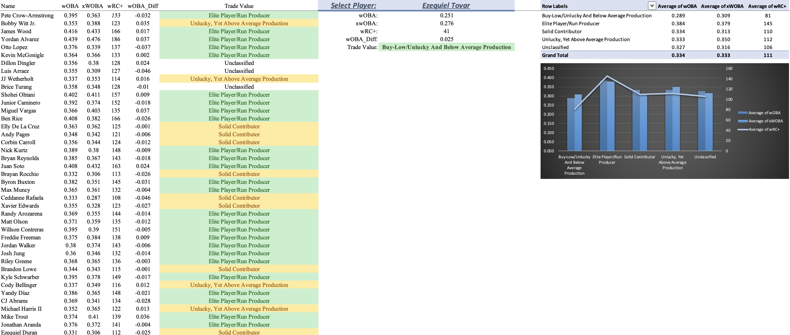

# MLB-Trade-Dashboard-Excel

## Overview
- The dashboard utilizes a player's expected and actual stats to find players who could be considered buy-low trade targets.
- This dashboard could be used by any baseball fan or front office to understand which players may be lucky or unlucky during the season. It also shows which players can be expected to slow down in production versus players who may become more productive.
- The data was taken during the 2026 MLB season prior to the MLB trade deadline.

## Key Findings
- Players like Bryson Stott, Masyn Winn, Nico Hoerner or Cam Smih were considered to be buy-low trade targets.
- Players like Pete Crow-Armstrong, Junior Caminero and Otto Lopez had higher actual stats than expected stats but because of their overall run prodcution they were still considered elite run producers, rather than lucky hitters.
- Ernie Clement was the luckiest hitter with a wOBA of 0.326 and an xwOBA of 0.275 (0.051 difference). The unluckiest hitter was Yordan Alvarez with a wOBA of 0.439 and an xwOBA of 0.476.

## Data
- Source: The data came from public Fangraphs publishings.
- Stats used: wOBA, xWOBA, wRC+, wOBA_Diff
- *Data is included in the Excel file.*

## How It Works
- I used a players wOBA and subtracted their xwOBA from it. This meant that a positive value in the wOBA_Diff column signified the player had worse expected stats than actual stats and vice versa.
- I used a long nested IF statement to decide where players belonged. Buy low players were players with low wRC+ with higher expected stats than actual stats. Players with unlucky performance but higher wRC+ were named unlucky but because of their above average production, they were not considered buy-lows. Then, the average players with wRC+ near 100 and slightly lucky performances were just considered solid contributors. The last group were the Elite Players who ahd wRC+ greater than 130. Some players were also deemed unclassified if their stats didn't fall into these thresholds.
- The user is able to use a dropdown of player names to search for specififc player's wOBA, xwOBA, wRC+ and their trade value. There is also an interactive pivot table and chart than can be changed to see the average statistics for each level of trade value.

## Dashboard Sheets
| Sheet | Description |
|---|---|
| `Trade_Board` | This is the main dashboard with all the findings and the interactive elements. |
| `Raw_Fangraphs` | This is the raw data from Fangraphs. |

## Limitations
- The model doesn't use salary or team control which is an important factor when it comes to deciding who to trade for.
- There are not a ton of aspects that the user can chnage when examining the different players. Things like plate appearances, position, etc could be important.

## Next Steps
- Add more interactive elemtns so the user can find players of specific positions, salary limits, years-of-control, etc.
- Add another classification so coaches or front office members know who should be trqaded away. This could be a sell-high feature for players with much higher actual stats compared to expected stats.

## Repository Files
| File | Description |
|---|---|
| `README.md` | Project documentation |
| `[file_name].xlsx` | The dashboard |

## How to Use
- Download and open `[file_name].xlsx` in Excel
- Click the dropdown next to select player to toggle the different players.
- The final list appears directly underneath the name of the player you selected.
